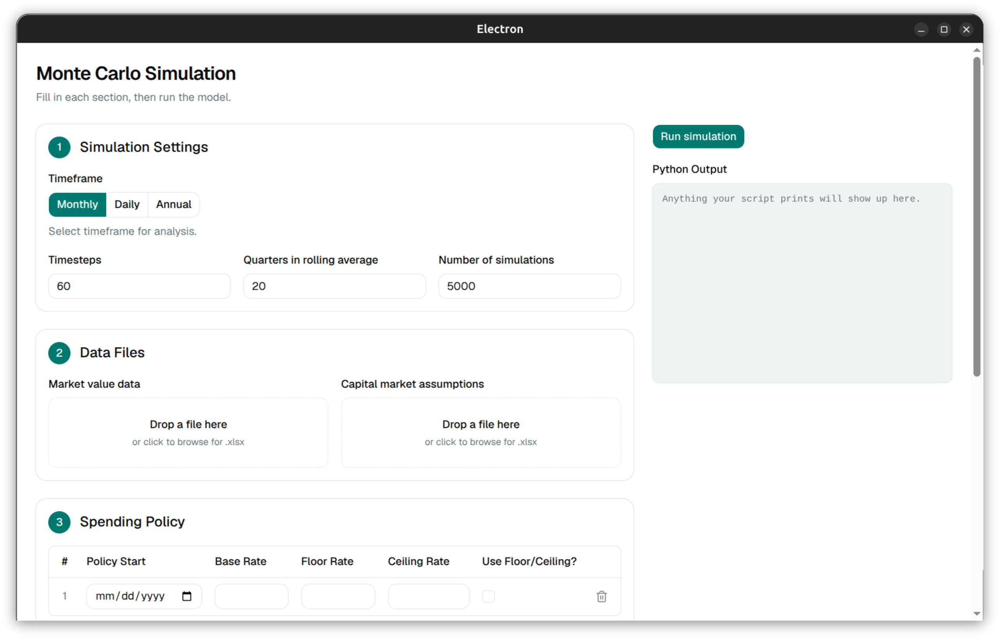

# Electron Applications

The fastest way to build a functional application for all users is to use Electron, a framework that uses JavaScript/TypeScript, HTML, and CSS to build cross-platform desktop applications. Specifically, we will use [electron-vite](https://electron-vite.org/) alongside [Tailwind CSS](https://tailwindcss.com/) and [shadcn/ui](https://ui.shadcn.com/). Together, these form a ready-to-use version of Electron with sensible defaults and most necessary components provided in advance.

---
# electron-app-configuration

This repository provides the foundational files for building a new Electron app that uses Python as a backend, including:
- `fresh_app.sh` for setting up the local development folder
- `fresh_app.env` for configuring inputs for `fresh_app.sh`
- pre-configured `src` folders:
	- `main`, includes `python.ts` for interacting with Python
	- `preload`
	- `renderer`, includes custom components as well as both a template and example script for `App.tsx`
	- `shared`, includes both template and example scripts for custom types and validations
- `python` for the backend bridge between Electron and the Python runtime
- `scripts` for build scripts
- Electron-specific configuration files

The template script `App.tsx` defaults to a two column GUI (see sample image below) but can be modified as needed.

Helpful docs for those unfamiliar with Javascript/Typescript:
- [Promise type](https://developer.mozilla.org/en-US/docs/Web/JavaScript/Reference/Global_Objects/Promise)
- [export statement](https://developer.mozilla.org/en-US/docs/Web/JavaScript/Reference/Statements/export)
- [interfaces](https://www.typescriptlang.org/docs/handbook/interfaces.html)

---
## Starting Development

### Install JavaScript

Javascript is necessary to use electron-vite apps. This project recommends installing [Node Version Manager](https://github.com/nvm-sh/nvm).
After installing `nvm`, run the following to install the latest stable version of [Node.js](https://nodejs.org/en):
`nvm install --lts`

### Run `fresh_app.sh`

Clone this repository to your projects folder.

Update the file `fresh_app.env` with appropriate inputs. Note `TEMPLATE_FILES_DIR` refers to the `app_template_files` subfolder. You can use either a literal or relative path.

In the projects folder, execute the `fresh_app.sh` script by running:
`bash ./fresh_app.sh`

This script does the following:
1. Loads `fresh_app.env` variables into active envrionment.
2. Builds the base electron-vite project folder and installs dependencies.
3. Installs Tailwind CSS.
4. Installs and sets up shadcn/ui.
5. Updates Electron configuration files.
6. Migrates template files.

Once complete, the workspace is ready for development. The script will display next steps in the terminal window.
